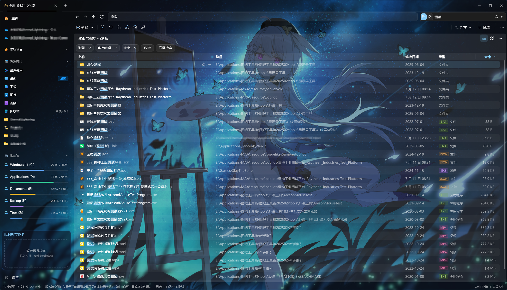

# Pulse

**为 Windows 打造的文件管理器，让浏览、搜索和整理文件更顺手。**

Pulse 将多窗口、多标签、多窗格、文件与正文搜索、预览和批量文件操作放在同一个工作空间。当前版本为 1.2.1.1，面向 Windows 10 和 Windows 11 x64。

本仓库提供基于 Pulse 的独立修改发行版，由 EternalLightning 维护，不代表原项目的官方发行。原项目由 jimmgreen 及其贡献者开发，原作者仓库：[jimmgreen/pulse](https://github.com/jimmgreen/pulse)。

源码采用 [Apache License 2.0](LICENSE)，发行版说明见 [NOTICE](NOTICE)。第三方组件遵循各自许可证，免安装包附带 `licenses` 目录。

[反馈问题](https://github.com/EternalLightning/pulse/issues)

## 让工作空间适合你

- 浅色、深色或跟随系统主题，标题栏一键切换；可选主题色、窗口效果（亚克力、Mica）、壁纸背景、界面透明度与背景模糊。
- 详细信息视图支持智能日期（「今天 14:32」「昨天 09:10」）、斑马纹行、彩色扩展名标签、大小比例条，列宽按内容自适应；右键列标题可选择显示哪些列。
- 七种颜色标签可以给文件和文件夹做标记，侧栏按标签汇总；也可以直接在资源管理器右键菜单中打标签。
- 侧栏分区可拖动排序、折叠，标签页可放到侧栏纵向排列（Ctrl+B 收起 / 展开）。

## 更快找到文件

- 通过 PulseIndex 索引搜索整盘文件名，结果实时更新；可以限定在当前文件夹或指定文件夹中搜索。
- 文件名搜索支持全拼、首字母和多音字，例如输入 `sh` 即可找到「品牌设计」「城市夜景」「山湖晨雾」，命中的文字会高亮。
- 内容搜索覆盖文本与代码、PDF、Word、Excel、PowerPoint 等格式，结果流式加载，打开所在位置后可后退回到原结果。
- 高级搜索（Ctrl+Shift+F）按类型、日期、大小等条件筛选；全局快速搜索（Alt+Space）随时呼出，也可以「在主界面搜索」查看全部结果。
- 地址栏输入 `cmd`、`powershell`、`pwsh` 或 `wt`，直接在当前文件夹打开终端。



## 多个目录，一起处理

- 单栏、左右分屏、上下分屏、三栏和四宫格布局（Ctrl+1/2/3/4），每个标签页保留自己的布局和位置。
- 分栏浏览同时展示上级、当前和选中的文件夹；平铺、图标、列表、详细信息和内容视图随时切换。
- 列表可按名称、日期、类型或大小分组，每个文件夹分别记住视图、排序和分组。
- 双栏文件夹对比标出两侧不同、缺失和较新的项目；后台统计文件夹大小。
- 详情面板显示预览、基本信息和标签；多选后可打开合并属性窗口。


## 空格快速预览

选中文件按空格即可预览，无需打开对应应用：

- Markdown 按排版显示，代码语法高亮，PDF 逐页翻看，文件夹显示内容列表。
- CSV / TSV / XLSX 以表格显示；JSON / XML 显示为可折叠的树，Jupyter Notebook 按单元格显示。
- DOCX、EPUB 和 Office 文档无需安装对应软件即可阅读；压缩包显示目录树并可在包内搜索。
- 视频可播放、拖动和逐帧，动态 WebP / APNG 可播放；另支持 SVG、PSD、AI、DWG 缩略图和字体等格式。

「设置 → 快速预览 · 支持的格式」列出全部可预览格式，并检测 HEIF / HEVC / AV1 / WebP 系统扩展是否已安装。

## 暂存盘与文本对比

复制或剪切（Ctrl+C / Ctrl+X）的文件会收进左下角的暂存盘，可以跨文件夹、跨标签页收集后一次拖到目标位置；拖放默认复制，按住 Shift 为移动。

暂存两个文件时可以对照位置、修改时间、大小和内容；文本文件点击「查看差异」打开对比窗口，支持并排 / 统一视图、行内差异高亮、仅看差异、忽略空白和大小写，以及 F7 / Shift+F7 跳转。

## 融入 Windows

- 可以在设置中把 Pulse 设为默认文件管理器，用于打开文件夹、Win+E 和桌面上的「此电脑」；「打开文件所在位置」会在 Pulse 中选中文件。随时可以关闭，恢复原样。
- 右键菜单合并资源管理器与 Windows 11 新式菜单项（如 VS Code、Windows Terminal、NanaZip），Pulse 自带项可以隐藏。
- 支持开机启动到托盘、设置默认位置、启动时恢复上次的标签页。
- 文件被占用时显示占用进程，可以结束进程后重试；「此电脑」显示磁盘类型和容量条。


## 从源码构建

使用 Windows x64、Visual Studio C++ 工具（含 Windows SDK）、CMake 3.25+ 和 Ninja，并确保 `cmake`、`ninja` 可在命令行中找到。便携包、产物校验与 CI 脚本另需 PowerShell 7.2+（`pwsh`）；安装包需要 Inno Setup 6。

在仓库根目录运行；脚本会自动查找并初始化 x64 Visual Studio 工具环境：

```powershell
.\build_release.bat
.\build-release\Pulse.exe
```

默认使用 Ninja 目录 `build-release`，构建六个交付程序：`Pulse.exe`、`Pulse.Index.exe`、`Pulse.Document.exe`、`Pulse.Preview.exe`、`Pulse.Shell.exe` 和 `Pulse.Integration.exe`。发布构建选择静态 MSVC 运行库（`/MT`）、关闭内嵌自测（`PULSE_WITH_SELFTEST=OFF`），仅构建交付目标及其依赖，不运行测试。

日常修改后，在已初始化的 x64 Visual Studio 开发者终端中只构建受影响目标，例如 `cmake --build build-release --target pulse`。`pulse` 会带上索引、Shell、预览、文档提取和集成程序；仅修改某个辅助模块时也可单独构建对应目标。

清理并重新配置已有 Ninja 目录可用 `.\build_release.bat /clean`。已有 NMake 目录即使加 `/clean` 也会被脚本拒绝，应另选新的 Ninja 目录。自定义目录、LumaText SDK 和定向测试见[构建与打包指南](docs/build-and-package.md)。

## 打包安装包与免安装包

在仓库根目录运行以下流程；每一步成功后再执行下一步：

```powershell
.\build_installer.bat
pwsh -NoProfile -File .\scripts\package_portable.ps1 -BuildDir build-release
```

两个产物的版本号均读取自 `version.txt`：

- 安装包：`dist\PulseSetup-<version>.exe`。
- 便携包：`dist\Pulse-<version>-portable-win-x64.zip`。

安装脚本先构建 Release，再检查六个程序的版本和原始文件名、内嵌自测标记及运行库依赖，最后编译安装包。便携包脚本直接使用现有构建文件，不负责构建。两个包均包含辅助程序、LumaText、PDFium、7-Zip 与第三方许可证；重复打包会覆盖同版本同名文件，需要保留旧包时先自行备份。

若刚完成同一份源码的 Release 构建，可以用 `.\build_installer.bat /skipbuild build-release` 跳过重复构建。`/skipbuild` 和便携包脚本都不检查源码是否已变更，也不运行功能测试。

生成后可核对便携包全部文件，并记录安装包的大小和 SHA-256：

```powershell
$version = (Get-Content .\version.txt -Raw).Trim()
pwsh -NoProfile -File .\scripts\verify_release_artifacts.ps1 `
    -BuildDir build-release `
    -ZipPath "dist/Pulse-$version-portable-win-x64.zip" `
    -InstallerPath "dist/PulseSetup-$version.exe" `
    -OutputJson "docs/validation/packaging-$(Get-Date -Format yyyyMMdd-HHmmss)/artifacts.json"
```

此校验不会解包核对安装器载荷或执行安装，也不会自动生成 `.sha256` 文件。安装包运行时需要管理员权限，可选择安装 PulseIndex 后台索引服务；便携包解压完整目录后运行 `Pulse.exe`，不会注册服务，配置、缓存和日志仍保存在用户应用数据目录。

完整命令、运行库检查、备份和校验文件生成见[构建与打包指南](docs/build-and-package.md)。生成包、替换现有安装和发布 GitHub Release 分别执行；当前打包命令不会更新已安装程序或上传产物。

## CI 与正式发布

`scripts/build_release_ci.ps1` 是独立的 Visual Studio 2022 v143 回归与安装包流程，默认目录为 `build-ci`，会运行多项测试，不用于日常增量构建。GitHub Actions 不会自动生成便携包，发布阶段依赖预先上传到对应草稿的 ZIP。`scripts/package_release.ps1` 的签名目录仍固定为 `build`，与当前默认构建目录不一致。

当前可用的本地交付路径以上述构建、安装包和便携包命令为准。CI 的前置条件、现有缺口、签名及上传步骤见[发布流程](scripts/RELEASE.md)；LumaText SDK 固定和静态运行库说明见[运行库与 SDK 文档](docs/static-runtime-packaging.md)。

技术栈为 C++20、Win32、Direct2D 和 DirectComposition。文件系统、索引、预览与 Shell 任务分别放在对应模块，避免阻塞界面。

更多说明：[索引存储与迁移](docs/index-migration.md)
