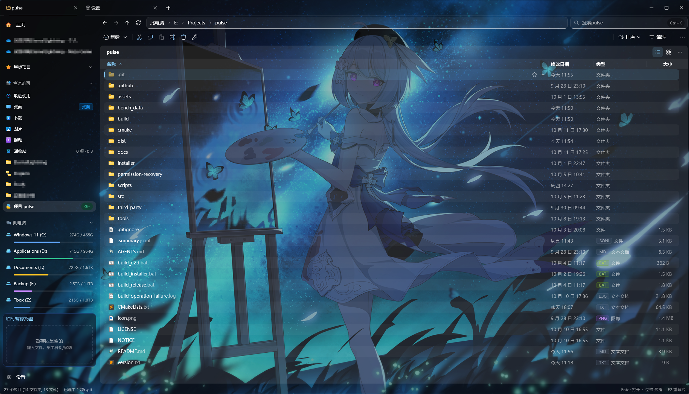

# Pulse

**为 Windows 打造的文件管理器，让浏览、搜索和整理文件更顺手。**

Pulse 将多标签、多窗格、文件与正文搜索、预览和批量文件操作放在同一个工作空间。当前版本为 1.1.2.0，面向 Windows 10 和 Windows 11 x64；另提供 Windows 8.1 兼容构建。

本仓库提供基于 Pulse 的独立修改发行版，由 EternalLightning 维护，不代表原项目的官方发行。原项目由 jimmgreen 及其贡献者开发，原作者仓库：[jimmgreen/pulse](https://github.com/jimmgreen/pulse)。

源码采用 [Apache License 2.0](LICENSE)，发行版说明见 [NOTICE](NOTICE)。第三方组件遵循各自许可证，免安装包附带 `licenses` 目录。

[下载本发行版](https://github.com/EternalLightning/pulse/releases/latest) · [查看更新记录](https://github.com/EternalLightning/pulse/releases) · [反馈问题](https://github.com/EternalLightning/pulse/issues)

## 文件管理

用标签页保留常用位置，并在多个窗格中并排浏览和整理目录。文件操作包含复制、移动、重命名、删除和撤销；长操作会显示进度，并支持取消和处理名称冲突。需要访问受保护位置时，Pulse 按操作请求 Windows UAC 授权，主程序继续以普通权限运行。

标签、暂存区、重复文件查找和压缩包工具可配合日常整理使用。打开图片时使用 Windows 默认查看器，并保留同目录图片浏览；目录内容按需读取，减少打开前的等待。

## 搜索与索引

按文件名搜索，并使用路径、类型等条件筛选结果；也可搜索文件正文。索引服务可选装，用于后台全盘索引。文件名搜索支持中文全拼和拼音首字母。

新版 Office 文档（DOCX、XLSX、PPTX）可直接提取正文建立内容索引。PDF 及旧版 Office 格式依赖系统中兼容的 IFilter；PDF 搜索针对已有文字层，不包含 OCR。


## 预览与外观

在文件管理器中预览支持的文件，使用浅色或深色主题，并可设置壁纸背景。界面采用多窗格布局，便于并排查看目录。




## 1.1.2.0 更新

- 管理员文件操作交由随程序提供的 Pulse.Shell.exe 执行；需要权限时通过标准 Windows UAC 请求授权。
- 图片打开路径减少不必要的 Shell 菜单处理，并将同目录图片列表读取延后到查看器需要时。
- 更新文件操作与压缩包进度界面，并改进压缩包错误反馈。

## 下载与安装

在发布页按系统选择安装包：

| 版本 | 适用系统 | 安装包 |
| --- | --- | --- |
| Windows 版（64位） | Windows 10 / Windows 11 | `PulseSetup-版本.exe` |
| Windows 8.1 兼容版（64位） | Windows 8.1 | `PulseSetup-版本-win81.exe` |

运行安装包，按向导完成安装。安装时可以启用 PulseIndex 服务，用于全盘索引搜索。

## 从源码构建

使用 Windows x64、Visual Studio C++ 工具、CMake 3.25+ 和 Ninja。发布构建另需 PowerShell 7.2+ 与 Inno Setup 6。

开发构建：

```powershell
.\build_release.bat
.\build\Pulse.exe
```

生成与正式发布相同的安装包，并运行回归检查：

```powershell
pwsh ./scripts/build_release_ci.ps1 -Channel windows
pwsh ./scripts/build_release_ci.ps1 -Channel win81 -BuildDir build-ci-win81
```

发布脚本使用 Visual Studio 2022 v143，并校验仓库内固定版本的 LumaText 静态运行库 SDK。`cmake/lumatext-sdk.json` 固定 SDK 清单的 SHA-256，清单覆盖 DLL、导入库、头文件、CMake 导出和许可证。开发构建可通过 `LUMATEXT_SOURCE_DIR` 指定源码；未找到 LumaText 时使用 DirectWrite。

技术栈为 C++20、Win32、Direct2D 和 DirectComposition。文件系统、索引、预览与 Shell 任务分别放在对应模块，避免阻塞界面。

更多说明：[Windows 兼容性](docs/windows-compatibility.md) · [索引存储与迁移](docs/index-migration.md)

程序图标采用 Files Community 的 [Files 图标](third_party/files-icon/README.md)，按 MIT 许可证使用；Pulse 与 Files Community 无关联。
