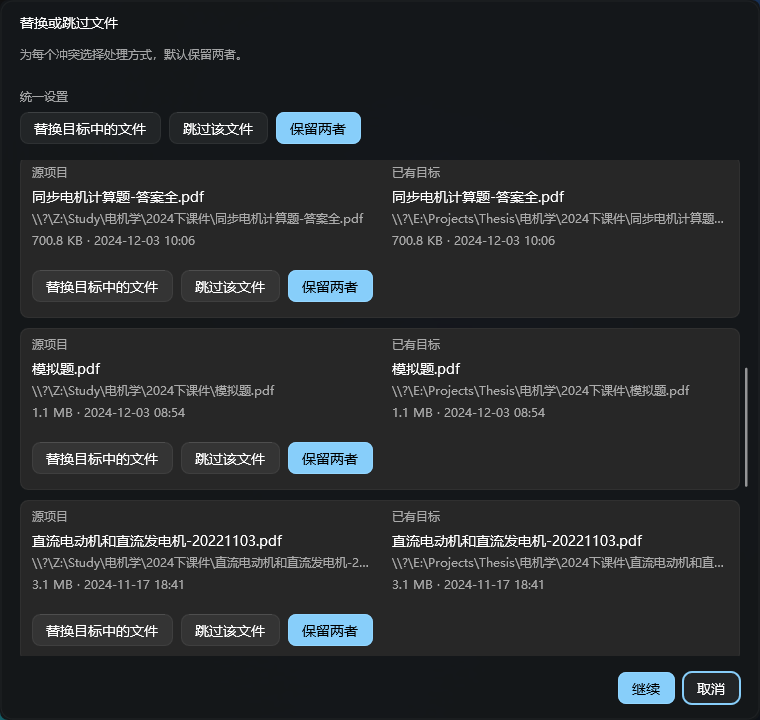
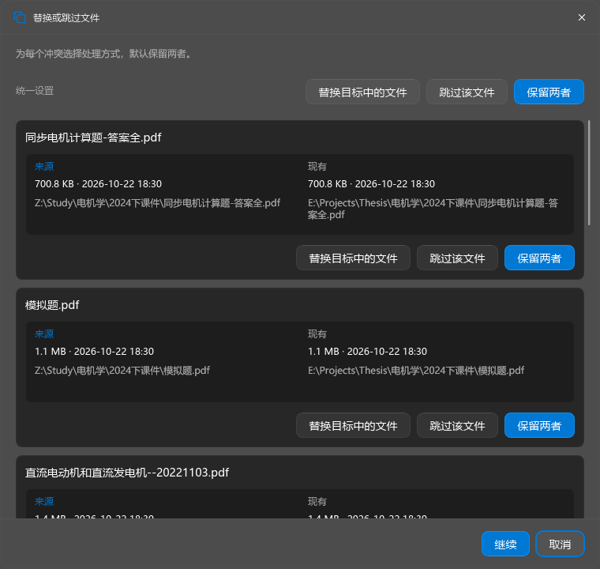

# 批量文件冲突弹窗调整

日期：2026-10-26。

## 改动

- 批量卡片只显示一次文件名，下方使用与单文件弹窗共用的详情绘制函数：来源／现有、大小与时间、两行路径。
- 顶部统一设置、每项的替换／跳过／保留两者按钮右对齐；空间不足时分行，每行保持右对齐。
- 统一标题栏图标、关闭按钮和底部分隔线。默认保留两者，支持统一设置后逐项修改。
- 显示路径使用现有 StripExtendedPathPrefix：`\\?\C:\...` 显示为 `C:\...`，`\\?\UNC\server\share\...` 显示为 `\\server\share\...`。操作模型仍保存原始路径。

## 截图

修改前与参考为用户提供的截图。修改后为隐藏原生窗口中调用生产渲染器获得的截图；默认态展示使用了示例文件名、大小与时间，没有访问这些实际文件。

| 用户提供的批量弹窗 | 修改后的批量弹窗 |
| --- | --- |
|  |  |

[单文件样式参考](reference-single-user.png) · [中文最窄窗口](after-narrow-dark.png) · [英文浅色最窄窗口](after-narrow-english-light.png)

## 实际验证

构建命令（通过 `scripts/vcvars.bat` 初始化 x64 MSVC）：

```text
cmake --build build-release --target pulse_batch_conflict_dialog_test pulse --parallel 4
```

主程序与定向 UI 测试目标构建成功，无新增编译警告。随后仅修改测试夹具并重建同一测试目标。

```text
build-release/pulse_batch_conflict_dialog_test.exe
```

最终结果：346 PASS / 0 FAIL，退出码 0，见 [最终日志](dialog-test.log)。

- 中英文、深浅主题、100%／125%／150%／200% DPI、760／620／360／340 DIP 宽度，共 64 组生产渲染截图。
- 检查元数据、按钮与固定页脚边界；检查所有按钮行右对齐及换行后无重叠。
- 鼠标统一设置与逐项覆盖、Space／Tab／Enter、Home／End、焦点滚动、取消、关闭、过期令牌及重复行 ID。
- 扩展盘符及 UNC 路径显示转换，同时验证操作模型中的原始路径不变。
- 人工查看了默认中文深色、中文最窄深色、英文最窄浅色、中文 125% DPI／620 DIP 等代表截图；自动几何检查覆盖全部 64 组。
- 本次涉及文件的 `git diff --check` 通过。

## 限制与异常记录

首次运行有一次前台窗口保持断言失败，264 PASS / 1 FAIL，见 [首轮日志](dialog-test-first-run.log)。同一构建复测为 265 PASS / 0 FAIL，见 [复测日志](dialog-test-recheck.log)。最终增加诊断信息并扩充本次布局覆盖后为 346 PASS / 0 FAIL。未确认首轮失败原因，未删除或弱化该断言，不能由后续通过推断首轮失败根因。

本次验证使用隐藏原生窗口和生产绘制代码，未更改用户偏好，未切换系统高对比度设置，也未在安装版中执行真实复制。单文件弹窗共用的详情绘制代码已随主程序编译，未另行测试其完整模态交互流程。没有运行全量历史回归。
